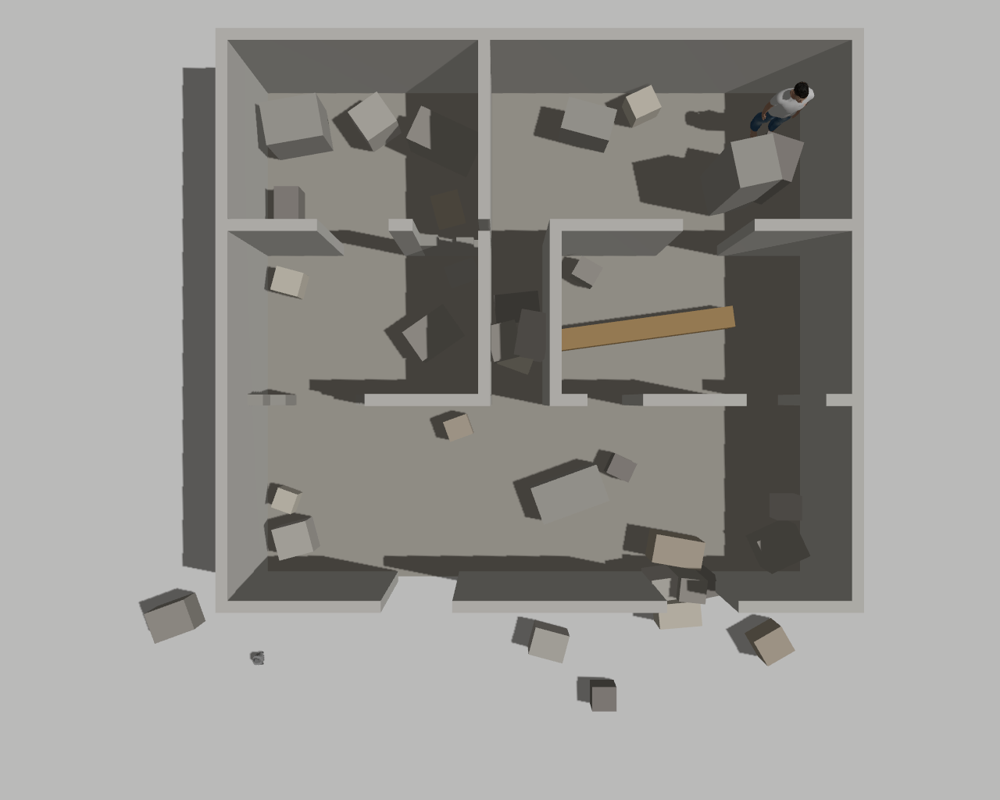
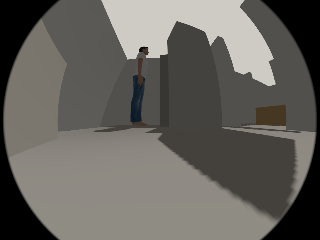
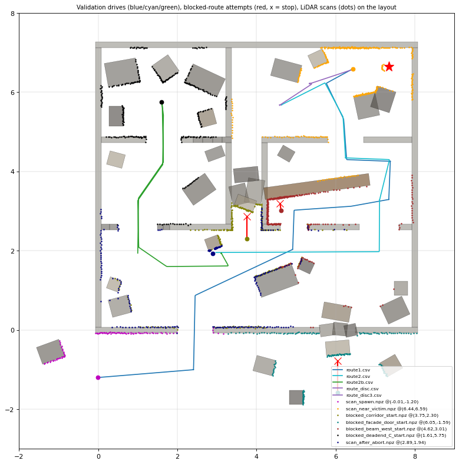

# Disaster Bot

**Camera + LiDAR victim detection and localization for a simulated search-and-rescue robot.**
ROS 2 Lyrical · Gazebo Sim 10 · TurtleBot3 `burger_cam` · YOLO11n · 2D LiDAR fusion

> **Research prototype, simulation only.** It has not been tested on hardware and is not intended for real emergency use. The project
> is **frozen** as of 2026-10-20. See [Final Status](final_docs_20261018/FINAL_STATUS.md), [Validation and Limitations](docs/VALIDATION_AND_LIMITATIONS.md), and the [published evidence index](evidence/README.md).
> No licence to reuse the original code is granted; see [Licensing](#licensing).

## Simulation Preview

### Disaster-Site Environment



### Robot Camera and Victim Detection



### Detection Validation




## Problem

After a building collapse, a robot has to find people and report **where** they are, without an operator.

- **Detecting** a person in a camera image is only half of the problem.
- To **approach** them, the robot needs that person's distance. A 2D LiDAR measures distances, but it does not know which return belongs to the person in a camera box.
- In rubble the nearest surface inside the box is often debris, a wall or a second person. A wrong distance can send the robot to the wrong place.

This project builds and measures a pipeline that turns YOLO person boxes into LiDAR distances. It adds a guard that **withholds** a distance when the LiDAR evidence does not support the box, and it documents, with ground truth, where that works and where it does not.

## What the frozen prototype does

1. **Detects people** in the robot's wide-angle camera with YOLO11n (COCO person class, confidence ≥ 0.50).
2. **Converts each box to a bearing range** with a calibrated model of the 182° fisheye lens.
3. **Measures distance** as the nearest well-supported LiDAR cluster in that range, after size and image-edge checks (`victim_distance_estimator`, frozen).
4. **Guards navigation** (`victim_detection_guard`): it forwards a box only if its single-box LiDAR association passes consistency checks (RVC: no LiDAR hit below the box bottom; support near the box centre; fresh, time-consistent inputs). Otherwise it publishes nothing for that box.
5. **Runs as a safe, stationary demonstration.** No node publishes motion commands; scenes are changed by teleporting models in Gazebo.

**Also in the code base** (earlier stage; *not* part of the frozen demonstration):
- an autonomous mission node (doorway entry, LiDAR frontier exploration, candidate confirmation, approach, stop beside the person);
- a separate SafetyController.

In **earlier simulation runs** (2026-10-07/08, before the navigation guard existed), single-victim 30-move missions reached the person in 6 of 6 runs. Those runs used a standing person model, flat floors and the default spawn pose. **They have not been repeated with the current guarded perception, and moving-robot operation of the current pipeline is not validated.**

## Architecture (frozen demonstration)

```
Gazebo (stationary robot)
  ├─ /camera/image_raw ──► yolo_detector ── /victim_detections ──► victim_detection_guard ── /victim_detections_nav ──► victim_distance_estimator ──► /victim_distance
  └─ /scan ──────────────────────────────────────────────────────────►┘ (RVC checks per box)                                  ▲
       └──────────────────────────────────────────────────────────────────────────────────────────────────────────────────┘
  victim_localizer (advisory per-person output, consumed by nothing) · demo watch.py (read-only monitor)
  NOT running: autonomous_search, safety_controller, obstacle_detector. /cmd_vel has 0 publishers.
```

| Node | Role |
|---|---|
| `yolo_detector` | YOLO11n person boxes with image timestamps (runs in its own Python venv) |
| `victim_detection_guard` | Per-box LiDAR association with RVC checks; forwards or withholds each box; publishes an audit of every decision |
| `victim_distance_estimator` | Frozen: the highest-confidence forwarded box → LiDAR range and bearing (`/victim_distance`) |
| `victim_localizer` | Advisory per-person localizer; not used by navigation |

More detail: see [Architecture](docs/ARCHITECTURE.md) and
[Validation and Limitations](docs/VALIDATION_AND_LIMITATIONS.md) for the
pipeline design and known failure modes.

## Technologies

- ROS 2 Lyrical (rclpy), Gazebo Sim 10 with `ros_gz`, TurtleBot3 `burger_cam`.
- Ultralytics YOLO11n: PyTorch, CPU inference, separate venv. YOLO-World v2-m is an optional detector for experiments.
- OpenCV / cv_bridge, NumPy.
- Python 3.14, pytest with ament lint tests, Ubuntu 26.04.

## Installation

Requires Ubuntu 26.04, ROS 2 Lyrical, Gazebo Sim 10 and TurtleBot3 Gazebo.
- The YOLO virtual environment goes at `<ws>/yolo_env`, created from `requirements-yolo.txt` (full lock in `requirements-yolo.lock.txt`).
- The `yolo11n.pt` weights go at `<ws>/yolo11n.pt`.

See [docs/SETUP_AND_RUN.md](docs/SETUP_AND_RUN.md) and [docs/YOLO_MODEL.md](docs/YOLO_MODEL.md).

```bash
source /opt/ros/lyrical/setup.bash
cd ~/ros2_ws && colcon build --packages-select my_first_robot
source install/setup.bash
```

## Safe stationary demonstration (the frozen demo)

The freeze-specific instructions are documented in
[Demo Guide](final_docs_20261018/DEMO_GUIDE.md). The original demonstration
helper scripts and freeze logs reside outside this repository, so this is
not currently a standalone, clone-and-run demonstration. See
[Setup and Run](docs/SETUP_AND_RUN.md) for the repository's setup documentation.

> **Safety:** Do not run `disaster_bot_full.launch.py` or
> `disaster_bot_posture.launch.py` for the stationary demo. They start
> `safety_controller` and `autonomous_search`, which can initiate a moving mission.

## Results (all in simulation; selected published evidence is indexed in [`evidence/`](evidence/README.md))

| Evidence | Result |
|---|---|
| Stationary demo smoke run, 2026-10-20 (detailed freeze report is not included in this repository) | Standing person at 1.8 m: 262 / 262 boxes forwarded, distance **1.707 m** (1.698–1.720). Person behind debris and standing-behind-lying scenes: **100 % withheld** (`lidar_hit_below_box`). Empty scene: 0 detections. 0 `/cmd_vel` publishers or messages; 0 mm odometry. |
| Automated tests, 2026-10-20 | **497 passed, 3 failed, 1 skipped**. The failures are long-standing and unchanged: one crossing-alignment test, flake8 style, pep257 docstrings. |
| Controlled stationary validation, production chain, YOLO11n: 56 trials, 15 scenes, ground-truth scored (`e1b_validation_20261019_222632`) | Standing 950 / 950 correct (median error 0.016 m); prone 361 / 361; kneeling / crouching 1244 / 1244; sitting 78.9 % correct (the rest withheld, 0 wrong); victim touching wall / beam 91.6 % correct, 7.7 % wrong-surface |
| Same validation: multi-person and occlusion | Close pairs: 78.4 % correct, 18.5 % "mixed" (distance within 0.05 m, but attribution ambiguous). Debris in front of the person: wrong-surface in 33 % (wider than the box) to **100 %** (debris inside the box span). |
| Fresh standing-with-lying placements (DEPTH-1, `depth1_20261020_105049`) | Production YOLO11n read the **lying person's distance for the standing person in 75.9 %** of reading frames |
| Earlier autonomous missions (2026-10-07/08, earlier build, before the navigation guard) | 6 / 6 single-victim 30-move missions reached the person. In the single-launch run the final stand-off was 0.939 m (ground truth), with 0 SafetyController interventions. Not repeated with the current pipeline. |

## Known limitations

- **Simulation only;** stationary validation only for the current perception pipeline. Moving-robot operation of the guarded pipeline is not validated. The guard pairs each image (typically 0.4 s old) with the *latest* scan, which is fine while stationary but not compensated for motion.
- **Not posture-independent.**
  - YOLO11n does not detect supine people at 1.8–2.0 m.
  - Sitting victims are partly withheld (21 %).
  - Tested postures use a small set of meshes and proxies.
- **Debris occlusion.** The 2D LiDAR (scan plane 0.18 m) and the low camera cannot tell debris inside or in front of the box from the person. The production chain then reports the debris distance, or the guard withholds. Measured as above.
- **Multiple people.** A standing person behind a lying person is invisible to the LiDAR. Depending on placement, production reports the lying person's distance (up to 76 % of frames). Close pairs give ambiguous attribution.
- **Identity.** The detector assigns no per-person identity, and the distance message carries no box or timestamp.
- YOLO-World v2-m (optional) detects more postures but is about 3.5× slower, and it produced wrong-person readings in multi-person scenes. It is **not** the default.

## Future work (experimental; not in the production pipeline)

- **Depth-based localization.** In a test-only Gazebo copy of the robot with a co-located depth camera (DEPTH-1), a per-box median-depth rule:
  - removed all standing-behind-lying wrong-person readings;
  - cut debris wrong-surface readings from 100 % to about 20 %;
  - still **failed** its pre-registered acceptance criteria.

  An offline follow-up found that spatially connected depth regions (an experimental rule) improve lying-victim and moderate-debris cases but not dominant debris. **Neither is implemented in the pipeline.** A pre-registered fresh-placement test (DEPTH-2) and per-frame RGB-depth person masks are the next steps.
- Image–scan time matching and motion compensation before any moving-robot use.
- Per-person identity carried from the detector to the distance output.

## Repository layout

```
src/my_first_robot/   ROS 2 package: nodes, launch files, tests
disaster_site/        Gazebo world, models, world generator, mission test harness
docs/  evidence/      documentation and curated validation records
requirements-yolo*.txt  YOLO venv requirements (direct pins + full lock)
```

The workspace root must also contain `yolo_env/` and `yolo11n.pt`; neither is in the repository. Older dated reports describe earlier project states. This README reflects the frozen demonstration described above; freeze-specific logs and helper scripts are not included in this repository.

## Licensing

**No licence is granted for the original project code.** This repository is published for viewing only. It is not released under an open-source
licence, and no permission to reuse, modify or redistribute the original code is given. The owner's licensing decision is still open.

Third-party components keep their own licences:
- The person detector depends on **Ultralytics YOLO11n (AGPL-3.0)**. Whether a view-only, no-licence repository is compatible with Ultralytics' licensing terms is **unresolved and needs further review**.
- The victim mesh is the Gazebo Fuel model *Standing person* (OpenRobotics), listed as CC0 1.0 (checked 2026-10-14).

See [docs/THIRD_PARTY_AND_LICENSING.md](docs/THIRD_PARTY_AND_LICENSING.md).
