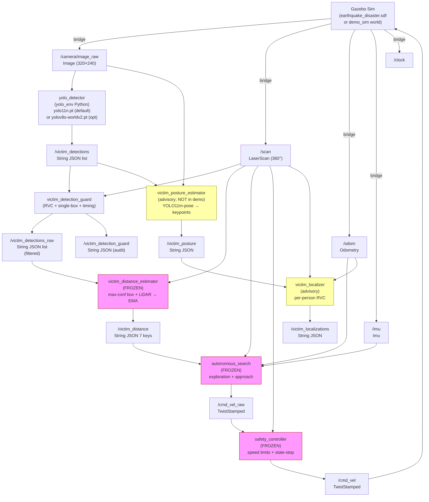

# Disaster Bot — Architecture

Verified against source files in `~/ros2_ws/src/my_first_robot/` as of 2026-10-18.
Frozen files (7) are identified by SHA-256 in `~/ros2_ws/evidence/SHA256SUMS.frozen`.

---

## 1. Full node and topic map

Pink = **frozen** (SHA-256 locked, never modified after 2026-10-08).
Yellow = **advisory** (not in the demo stack; posture estimator not run in the final demo).

---

## 2. Component reference

### 2.1 Simulation — Gazebo Sim 10.4.0

**Demo world:** `~/disaster_bot_test_logs/detector_eval_20261018_000055/demo/site/`
(spawns `turtlebot3_burger_cam` at pose `(3.0, −6.6, yaw=1.5708)` in the disaster-site world).

**Full mission world:** `~/ros2_ws/disaster_site/world/earthquake_disaster.sdf`
(spawn `(0.0, −1.2)` outside the building).

Bridges started by the sim launch:
- `ros_gz_bridge`: `/clock`, `/odom`, `/scan`, `/imu`, `/tf`, `/joint_states`, `/camera/camera_info`, `/cmd_vel` (TwistStamped ROS→Gazebo)
- `ros_gz_image`: `/camera/image_raw`

### 2.2 `yolo_detector` (`yolo_detector.py`)

- Subscribes: `/camera/image_raw`
- Publishes: `/victim_detections` (std_msgs/String, JSON list of box dicts)
- Run with `yolo_env/bin/python` from `~/ros2_ws` (cwd matters for default weight path).
- **Parameters** (post 2026-10-18 rebuild):
  - `model_path` (default `'yolo11n.pt'`) — relative to cwd or absolute path
  - `confidence_threshold` (default `0.50`) — must be in (0, 1]
  - `use_sim_time` (default `false`)
  - `latest_frame_only` (default `true`) — skips queued frames
- Class filter: `classes=[0]` (COCO person only). Validates that class 0 is `person`.
- Box dict keys: `victim_id`, `confidence`, `bbox` (dict), `center.x`, `image_stamp`, `timestamp`.
- Live detector rate: ~8 Hz for YOLO11n, ~3.5 Hz for YOLO-World v2-s (CPU, i7-1355U).

### 2.3 `victim_detection_guard` (`victim_detection_guard.py`)

- Subscribes: `/victim_detections`, `/scan`
- Publishes: `/victim_detections_nav` (forwarded), `/victim_detection_guard` (audit)
- **Parameters:** `exclusive_cluster_check` (default `false`), `max_image_age_s` (1.0 s), `scan_timeout_s` (0.5 s)
- Forwards a frame only if **all** boxes in it pass RVC (no LiDAR hit below the bottom of the box; LiDAR support in the box centre), single-box association, scan freshness (≤ 0.5 s), image freshness (≤ 1.0 s), and the estimator contract (all required fields present and `center.x` at the midpoint).
- The optional `exclusive_cluster_check` (close-pair guard) withholds frames where two boxes compete for the same LiDAR cluster. **Default off; not Gazebo-validated.**
- When the guard is inactive, the estimator subscribes directly to `/victim_detections`.

### 2.4 `victim_distance_estimator` — **FROZEN** (`victim_distance_estimator.py`, `4e1e976c`)

- Subscribes: `/victim_detections_nav` (or `/victim_detections` when guard is off), `/scan`
- Publishes: `/victim_distance` (std_msgs/String, 7-key JSON)
- Selects the **max-confidence** box, finds the nearest LiDAR cluster supported in the box's column, applies an exponential moving average (EMA), and publishes range, bearing, confidence, victim_id, and timestamps.
- The `detection_age_s` field is the wall-clock age of the ROS message, **not** the image capture time.
- One reading per camera frame; no reading if the scan or box fails the association.

### 2.5 `autonomous_search` — **FROZEN** (`autonomous_search.py`, `2b2b92e1`, + `exploration_grid.py` + `victim_prioritizer.py`)

- Subscribes: `/victim_distance`, `/scan`, `/odom`, `/imu`
- Publishes: `/cmd_vel_raw` (TwistStamped), `/victim_found`
- States: building entry → exploration → candidate confirmation → approach → VICTIM_HOLD / INSIDE_HOLD / FAULT_HOLD.
- `VICTIM_MIN_CONFIDENCE = 0.60` (line 946): ignores any `/victim_distance` reading with confidence < 0.60.
- Navigation stops at the first VICTIM_HOLD.
- **NOT started in the stationary demo.**

### 2.6 `safety_controller` — **FROZEN** (`safety_controller.py`, `ccecad4f`)

- Only `/cmd_vel` publisher.
- Subscribes: `/cmd_vel_raw`, `/scan`; applies forward/reverse speed limits near obstacles and zeroes output on stale inputs.
- **NOT started in the stationary demo.**

### 2.7 `victim_posture_estimator` (advisory, `victim_posture_estimator.py`)

- Subscribes: `/camera/image_raw`, `/victim_detections`
- Publishes: `/victim_posture` (advisory JSON)
- Runs with `yolo_env/bin/python`, requires YOLO11m-pose weights (`yolo11m-pose.pt`).
- No posture classification. Publishes keypoints and orientation hints only.
- **Nothing in the validated mission or demo consumes `/victim_posture`** for distance or motion.
- Not started in the final demo configuration (Segment A).

### 2.8 `victim_localizer` (advisory, `victim_localizer.py` + `victim_localizer_core.py`)

- Subscribes: `/victim_posture`, `/scan`, `/odom`
- Publishes: `/victim_localizations` (advisory JSON, per-person)
- Optional parameter `rvc_enabled` (default `false`; set `true` in demo).
- Mode `auto` (default): uses the fused `/victim_posture` candidates while that stream is active; falls back to `/victim_detections` candidates after pose node exits.
- **Nothing in the validated mission or demo consumes `/victim_localizations`.**
- Included in the demo for observability only.

---

## 3. Topics quick reference

| Topic | Type | Producer | Consumer(s) |
|---|---|---|---|
| `/camera/image_raw` | sensor_msgs/Image | ros_gz_image | yolo_detector, victim_posture_estimator |
| `/scan` | sensor_msgs/LaserScan | ros_gz_bridge | victim_detection_guard, victim_distance_estimator, autonomous_search, safety_controller, victim_localizer |
| `/odom` | nav_msgs/Odometry | ros_gz_bridge | autonomous_search, victim_localizer |
| `/imu` | sensor_msgs/Imu | ros_gz_bridge | autonomous_search |
| `/victim_detections` | std_msgs/String (JSON) | yolo_detector | victim_detection_guard (or estimator when guard off), victim_posture_estimator |
| `/victim_detections_nav` | std_msgs/String (JSON) | victim_detection_guard | victim_distance_estimator |
| `/victim_detection_guard` | std_msgs/String (JSON) | victim_detection_guard | (audit / demo_watch) |
| `/victim_distance` | std_msgs/String (JSON) | victim_distance_estimator | autonomous_search |
| `/victim_posture` | std_msgs/String (JSON) | victim_posture_estimator | victim_localizer |
| `/victim_localizations` | std_msgs/String (JSON) | victim_localizer | (nothing in production) |
| `/cmd_vel_raw` | geometry_msgs/TwistStamped | autonomous_search | safety_controller |
| `/cmd_vel` | geometry_msgs/TwistStamped | safety_controller | ros_gz_bridge → Gazebo |

---

## 4. Launch files

| File | Status | What it starts |
|---|---|---|
| `disaster_bot_full.launch.py` | **DO NOT USE in demo** | Full mission: Gazebo, robot, perception, autonomous_search, safety_controller |
| `disaster_bot_posture.launch.py` | **DO NOT USE in demo** | Same as full, plus posture nodes; includes safety_controller + autonomous_search |
| `disaster_bot.launch.py` | Utility | Launches TurtleBot3 house world only |
| `robot.launch.py` | Utility | Robot model + state publisher |
| `$DEMO/demo_stack.launch.py` | **Demo use** | yolo_detector + victim_detection_guard + victim_distance_estimator + victim_localizer (no motion nodes) |
| `$DEMO/site/launch/demo_sim.launch.py` | **Demo use** | Gazebo + robot + bridges (no perception, no motion) |

`$DEMO` = `~/disaster_bot_test_logs/detector_eval_20261018_000055/demo/`

---

## 5. YOLO-World v2-s optional configuration

When `detector:=worldv2s` is passed to `demo_stack.launch.py`, the same `yolo_detector` node is launched with:
- `model_path` = path to `yolov8s-worldv2.pt` (kept outside the workspace)
- `confidence_threshold` = 0.20
- `latest_frame_only` = false

All downstream nodes (guard, estimator, localizer) are unchanged and consume the same message schema. The navigation node's 0.60 confidence bar (`VICTIM_MIN_CONFIDENCE`) is a frozen constant; at that threshold, the number of independent lying-proxy views detected by YOLO-World (5/58) equals YOLO11n (5/58).

**YOLO-World is experimental, not the default, and is not validated for navigation.**
